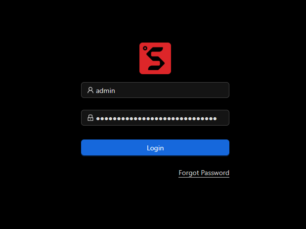
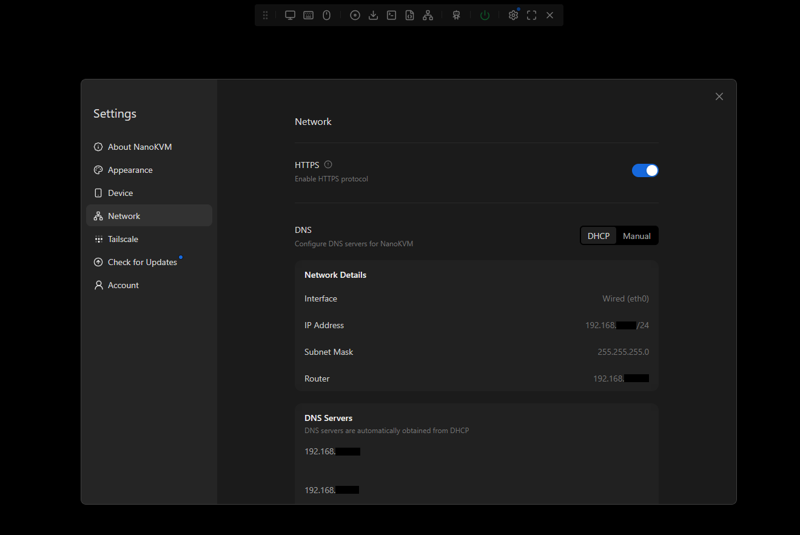
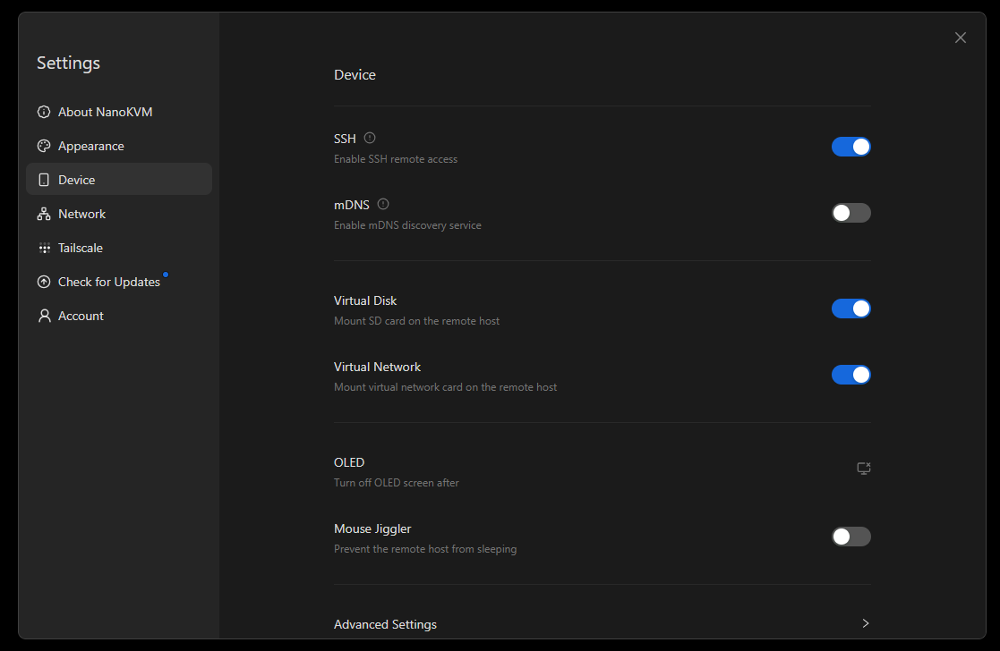

# Let's Encrypt (ACME) certificate on NanoKVM

Replace the self-signed TLS certificate of a NanoKVM with a Let's Encrypt certificate, with automatic renewal using **acme.sh** and the **Cloudflare DNS-01** challenge.

> Tested on: NanoKVM firmware **2.4.3**, Buildroot 2023.11.2 (riscv64), acme.sh v3.1.7. The example uses a **wildcard** certificate `*.domain.com` and a KVM reachable at `kvm.domain.com`.

> **Disclaimer:** this procedure was written with the help of **Claude Opus 5.5**. This procedure was verified and corrected by a real human (me).

---

## 0. Prerequisites

| Item | Details |
|---|---|
| Access | Admin account on the NanoKVM web interface |
| Internal DNS | The FQDN (e.g. `kvm.domain.com`) resolves to the KVM's IP address |
| Public DNS | The `domain.com` zone is hosted on **Cloudflare** |
| Internet access | Outbound HTTPS (443) to `acme-v02.api.letsencrypt.org`, `api.cloudflare.com` and `github.com` |
| Time | `ntpd` running (the clock must be correct for TLS) |
| DNS Token API | You must already have your DNS Token API to write on your DNS records. |

**Why DNS-01?** The KVM has a private IP address, so Let's Encrypt cannot reach it for an HTTP-01 challenge. DNS-01 does not require exposing the KVM, and it is **the only challenge accepted for a wildcard certificate**.

### ACME.sh

This procedure will use ACME.sh. You can get more info of the software here :
- https://github.com/acmesh-official/acme.sh

---

## 1. Enable HTTPS from the web interface

First, enable HTTPS on the NanoKVM.

Log in to the web interface of your KVM, e.g. `http://192.168.1.10`.



Once logged in, go to **Settings > Network** and turn on **HTTPS**.



The NanoKVM then generates a self-signed certificate (`CN=localhost`) and listens on port 443. It will be replaced in the following steps.

---

## 2. Enable SSH from the web interface

Still in the web interface, go to **Settings > Device** and check **SSH**.



---

## 3. Connect and check

```bash
ssh root@kvm.domain.com
```

*Same password as the WebUI login.*

```bash
# Current TLS configuration of the NanoKVM server
cat /etc/kvm/server.yaml          # proto: https, cert.crt / cert.key

# Certificate currently served (self-signed, CN=localhost)
echo | openssl s_client -connect 127.0.0.1:443 2>/dev/null | openssl x509 -noout -subject -issuer -dates

# DNS resolution and access to Let's Encrypt
nslookup kvm.domain.com
curl -sS -o /dev/null -w "%{http_code}\n" https://acme-v02.api.letsencrypt.org/directory   # expected: 200
```

---

## 4. Install acme.sh

> ⚠️ BusyBox `tar` does not support `-z`, so the archive is decompressed with `gunzip`.

```bash
mkdir -p /root/acme-src && cd /root/acme-src
curl -sSL https://github.com/acmesh-official/acme.sh/archive/refs/heads/master.tar.gz -o acme.tar.gz
gunzip -c acme.tar.gz | tar xf -
cd acme.sh-master
./acme.sh --install --home /root/.acme.sh --nocron --no-profile
cd / && rm -rf /root/acme-src

/root/.acme.sh/acme.sh --version
/root/.acme.sh/acme.sh --set-default-ca --server letsencrypt
```

`--nocron`: the crontab is set up manually in step 7, because the default location is not persistent.

---

## 5. Issue the certificate

*In my case, I am using Cloudflare. If you're not using Cloudflare, this command will not work. You need to check with your domain provider here : https://github.com/acmesh-official/acme.sh/wiki/dnsapi*

```bash
CF_Token='YOUR_CLOUDFLARE_TOKEN' \
/root/.acme.sh/acme.sh --issue --dns dns_cf -d '*.domain.com' --keylength ec-256
```

Expected result: `Cert success.` then `Your cert is in: /root/.acme.sh/*.domain.com_ecc/...`

> The quotes around `'*.domain.com'` are required, otherwise the shell expands `*`.

The token is saved automatically for renewals:

```bash
grep -c '^SAVED_CF_Token' /root/.acme.sh/account.conf   # expected: 1
```

> Outbound DNS (UDP 53) may be blocked. This is not a problem: acme.sh checks propagation with DNS-over-HTTPS.

---

## 6. Install the certificate for NanoKVM

The certificate goes into a **dedicated directory**, `/etc/kvm/acme/`. `NanoKVM-Server` can regenerate a self-signed certificate (`utils.GenerateCert`) at the default paths `/etc/kvm/server.crt|key`, which would overwrite ours.

### 6.1 Directory and config backup

```bash
mkdir -p /etc/kvm/acme && chmod 700 /etc/kvm/acme
cp -p /etc/kvm/server.yaml /etc/kvm/server.yaml.bak-selfsigned
```

### 6.2 Point `server.yaml` to the new certificate

```bash
sed -i 's#^    crt: /etc/kvm/server.crt#    crt: /etc/kvm/acme/fullchain.pem#; s#^    key: /etc/kvm/server.key#    key: /etc/kvm/acme/privkey.pem#' /etc/kvm/server.yaml
grep -A2 '^cert:' /etc/kvm/server.yaml
```

Expected:

```yaml
cert:
    crt: /etc/kvm/acme/fullchain.pem
    key: /etc/kvm/acme/privkey.pem
```

### 6.3 Deploy the certificate and set the reload command

```bash
/root/.acme.sh/acme.sh --install-cert -d '*.domain.com' --ecc \
  --key-file       /etc/kvm/acme/privkey.pem \
  --fullchain-file /etc/kvm/acme/fullchain.pem \
  --reloadcmd      "/etc/init.d/S95nanokvm restart >/dev/null 2>&1 </dev/null"
```

acme.sh remembers these paths and the `reloadcmd`, and reuses them on every renewal. The server restarts immediately (`Reload successful`).

---

## 7. Automatic renewal (crond)

> ⚠️ On this Buildroot system, `crond` is not started at boot, and `/var/spool` points to `/tmp` (tmpfs, **wiped on reboot**). The crontab is therefore stored in `/etc/crontabs`.

### 7.1 Persistent crontab

```bash
mkdir -p /etc/crontabs
echo '17 3 * * * /root/.acme.sh/acme.sh --cron --home /root/.acme.sh >> /root/.acme.sh/cron.log 2>&1' > /etc/crontabs/root
chmod 600 /etc/crontabs/root
```

> Tip: use a different minute on each KVM.

### 7.2 crond startup script

```bash
cat > /etc/init.d/S90crond <<'EOF'
#!/bin/sh
# crond for ACME renewal (acme.sh) - persistent crontabs in /etc/crontabs
case "$1" in
  start)   /usr/sbin/crond -c /etc/crontabs -L /dev/null ;;
  stop)    killall crond 2>/dev/null ;;
  restart) killall crond 2>/dev/null; sleep 1; /usr/sbin/crond -c /etc/crontabs -L /dev/null ;;
  *) echo "Usage: $0 {start|stop|restart}"; exit 1 ;;
esac
EOF
chmod +x /etc/init.d/S90crond
/etc/init.d/S90crond start
ps w | grep '[c]rond'
```

### 7.3 Test the cron job

```bash
/root/.acme.sh/acme.sh --cron --home /root/.acme.sh
```

Expected: `Skipping. Next renewal time is: ...` (renewal happens about 30 days before expiry).

---

## 8. Final check

```bash
# Server restarted
pidof NanoKVM-Server kvm_system

# Certificate served
echo | openssl s_client -connect 127.0.0.1:443 -servername kvm.domain.com 2>/dev/null \
  | openssl x509 -noout -subject -issuer -dates
# subject=CN = *.domain.com / issuer=... Let's Encrypt ...

# Full TLS validation
curl -sS -o /dev/null -w "%{http_code}\n" https://kvm.domain.com/    # expected: 200
```

Then open `https://kvm.domain.com` in a browser: there should be no more security warning.

> ℹ️ The `*.domain.com` certificate is only valid for names like `xxx.domain.com`, one level deep: neither `domain.com` itself nor `a.b.domain.com`. Accessing the KVM by IP address or short name (`https://kvm`) will still show a warning.

---

## Files summary

| Path | Purpose |
|---|---|
| `/root/.acme.sh/` | acme.sh, Let's Encrypt account, Cloudflare token (`account.conf`), domain config |
| `/etc/kvm/acme/fullchain.pem` | Certificate + chain |
| `/etc/kvm/acme/privkey.pem` | EC-256 private key |
| `/etc/kvm/server.yaml` | NanoKVM config (points to `/etc/kvm/acme/`) |
| `/etc/kvm/server.yaml.bak-selfsigned` | Backup of the original config |
| `/etc/crontabs/root` | Daily renewal job |
| `/etc/init.d/S90crond` | Starts crond at boot |
| `/root/.acme.sh/cron.log` | Renewal log |

---

## Operations

**Force a renewal (test):**

```bash
/root/.acme.sh/acme.sh --renew -d '*.domain.com' --ecc --force
```

**Check the status:**

```bash
/root/.acme.sh/acme.sh --list
tail -n 30 /root/.acme.sh/cron.log
```

**Go back to the self-signed certificate:**

```bash
cp /etc/kvm/server.yaml.bak-selfsigned /etc/kvm/server.yaml
/etc/init.d/S95nanokvm restart
```

**After a NanoKVM firmware update**, check that:

- `/etc/init.d/S90crond` still exists and `crond` is running;
- `/etc/kvm/server.yaml` still points to `/etc/kvm/acme/`;
- the certificate served is still the Let's Encrypt one (step 8).

---

## Things to keep in mind

- **Downtime**: each renewal (about every 60 days, around 03:17) restarts `NanoKVM-Server`, so the web interface is unavailable for a few seconds.
- **Security**: the Cloudflare token is stored in plain text in `/root/.acme.sh/account.conf` (readable by root only). Restrict it to the relevant zone only.
- **Wildcard**: the `*.domain.com` private key is valid for every subdomain. If one KVM is compromised, the key is compromised for the whole zone. Use a per-host certificate (`-d kvm.domain.com`) if that risk is not acceptable.
- **SSH access**: prefer key-based authentication over passwords, and disable SSH in the web interface if you don't need it.